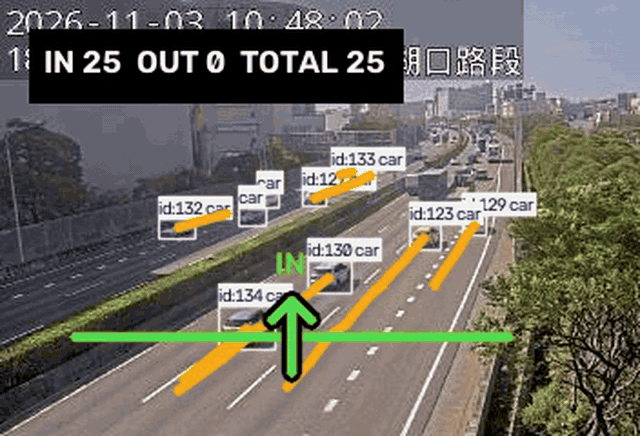
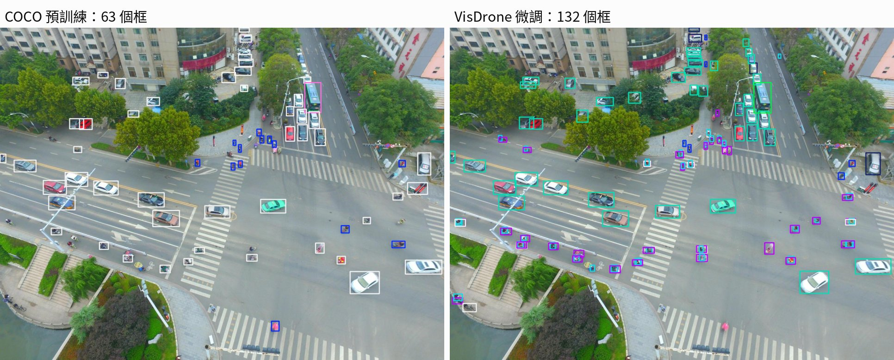
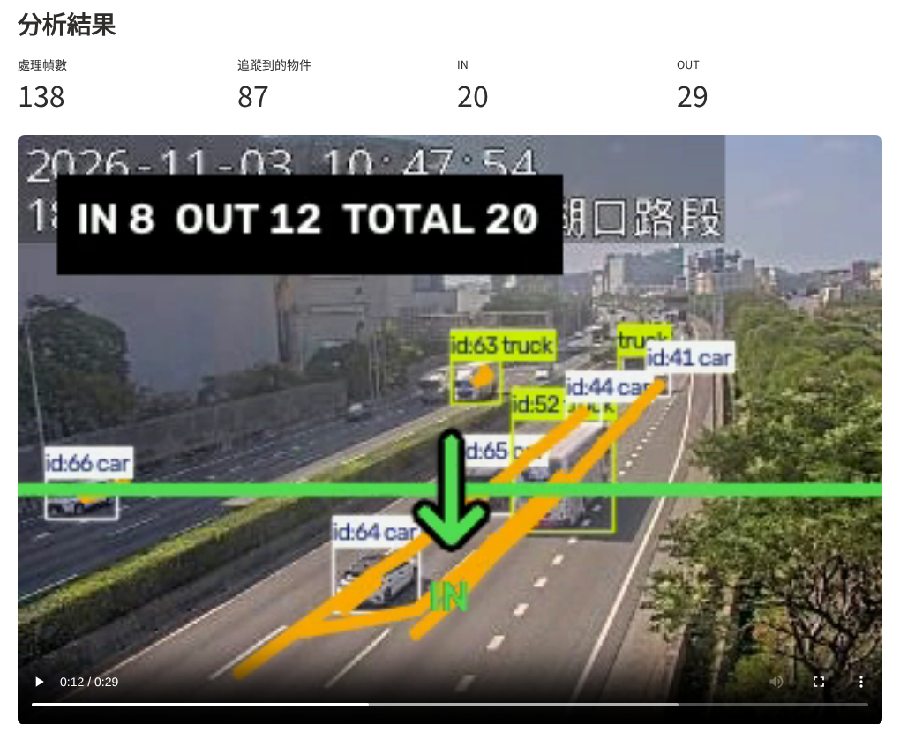

# 🚦 Traffic Vision

**基於 YOLO26 的交通影像分析工具**

🔗 **線上展示：<https://superhero-plow-headway.ngrok-free.dev>**（需要密碼，請來信索取；第一次開啟會出現 ngrok 提醒頁，按 Visit Site 進入）


<p align="center">
  
  <br><sub>國道 1 號湖口 CCTV（約 5 fps，YOLO26m）：多目標追蹤與越線計數，橘線為軌跡</sub>
</p>

## 問題定義

現成的 YOLO 權重是用 COCO（日常照片）訓練的，直接拿來分析交通影像會遇到三個問題：

1. **空拍畫面**：車和機車只有幾個像素大，大部分都偵測不到。
2. **機車、騎士很多的街景**：和 COCO 的資料分布不同，台灣這類路況特別明顯。
3. **低幀率 CCTV**：國道 CCTV 只有約 5 fps，車子一幀就移動將近一個車身。內建追蹤器靠前後框的 IoU 配對，只留下 3% 的偵測框，越線計數嚴重漏算。

這個專案分別處理這三個問題，量化「換一個領域，模型會忘掉多少」，最後把成果整合成可以上傳影片使用的 Web App。

## 結論摘要

| 問題 | 做法 | 結果 |
| --- | --- | --- |
| 空拍小物體 | 在 VisDrone 上微調 YOLO26s | 共同 6 類 mAP50 **0.206 → 0.487**，機車約提升 4.5 倍 |
| 平視街景 | 在 IDD 上微調，依影片序列切分 | 共同 6 類 mAP50 **0.478 → 0.712** |
| 跨領域遺忘 | 3 個模型 × 3 個測試集 | 每個專用模型都只在自己的領域最好；空拍模型在 IDD 只剩 0.174，IDD 模型在 VisDrone 只剩 0.034 |

<p align="center">
  
</p>

## 資料

| 資料集 | 視角 | 用途 | 評估方式 |
| --- | --- | --- | --- |
| [COCO](https://cocodataset.org/) val2017 | 一般照片 | 預訓練基準、檢查遺忘 | 5,000 張 |
| [VisDrone2019-DET](https://github.com/VisDrone/VisDrone-Dataset) | 無人機空拍 | 微調 | test-dev（1,610 張），另依官方規則處理忽略區域 |
| [IDD Detection](https://idd.insaan.iiit.ac.in/) | 印度道路平視 | 微調 | 依影片序列切分，避免相鄰幀洩漏到測試集 |
| 國道 1 號湖口 CCTV | 高處固定攝影機，約 5 fps | 驗證追蹤與計數 | 人工逐幀計數 |

- 所有分數都來自訓練過程完全沒用到的測試集，驗證集只用來挑最佳 epoch。
- 三個資料集的類別不同，跨資料集比較只看共同的 6 類（人、腳踏車、汽車、機車、公車、卡車）。
- 評估流程檢查：預訓練模型在 COCO 80 類的 mAP50-95 為 0.480，和官方公布值相差不到 1 點。

## 方法

### 1. 領域微調

從 COCO 權重開始，對 YOLO26s 做全參數微調，分別訓練空拍（VisDrone，訓練解析度 1536）和平視（IDD，1024）兩個專用模型。

### 2. 低幀率多目標追蹤

[`traffic_vision/tracking.py`](traffic_vision/tracking.py) 沿用 ByteTrack 的流程（高低信心兩階段配對、遺失後找回），但改了三個地方：

- **配對成本**：把框的 IoU 換成「預測位置與偵測中心的距離」。速度由最近兩次觀測估計，距離以框的大小為單位，所以和幀率、物體遠近都無關。
- **類別去重**：同一台車常同時被判成 car 和 truck，四輪車類別之間先去重。騎士和機車本來就會重疊，所以不合併。
- **新軌跡也能計數**：低幀率下車子可能剛出現就越線，所以還沒確認的軌跡也會把第一個位置交給計數器。

### 3. 從軌跡算出交通指標

- **雙向越線計數**：用線段相交判斷，計數線可以設成任意角度，每台車只算一次。
- **區間測速**：車速 = 兩條線的實際距離 ÷ 通過時間差，越線時間依前後兩幀內插。
- **TTC 接近事件**（行車紀錄器）：框的大小和距離成反比，因此 TTC = 1 ÷ (d ln s / dt)，不需要知道實際距離。

## 主要發現

**1. 微調後能抓到密集的小物體。** 下圖是同一張 VisDrone 測試圖（標註了 170 個物件），左邊是 COCO 預訓練模型，右邊是空拍微調模型。



**2. 訓練和推論的解析度要一起提高。**（VisDrone 官方規則，10 類 mAP50）

| 設定 | mAP50 |
| --- | --- |
| 1024 訓練、1024 推論 | 0.412 |
| 1024 訓練、1536 推論 | 0.447 |
| 1536 訓練、1536 推論 | **0.471** |

只把推論解析度提高到 1536，不必重訓就能多 0.035。

**3. 起始權重影響不大。** 從 COCO 起點或從 Objects365 → DOTA（空拍）起點開始微調，差距不到 0.01。

**4. 低幀率追蹤大幅改善。**（國道 1 號湖口 CCTV，YOLO26m，conf 0.2）

| 片段 | 人工計數 | 內建追蹤器 | 本專案 |
| --- | --- | --- | --- |
| 0–10 秒（用來調參數） | 12–13 | 7 | **12** |
| 20–30 秒（獨立驗證） | 約 13 | — | **12** |

30 fps 的行車影片也一起變好：軌跡覆蓋率 83% → 94%，追蹤 ID 數 108 → 85（同一個物件比較不會被切成好幾段）。

完整設定與數字見 [docs/experiments.md](docs/experiments.md)，原始評估報告在 [reports/](reports/)。

## 應用：Traffic Vision App

<p align="center">
  
  
</p>

| 頁面 | 功能 |
| --- | --- |
| 🖼️ 影像偵測 | 物件偵測或實例分割，可以匯出偵測明細（CSV / Excel） |
| 🎞️ 影片追蹤與計數 | 多目標追蹤、任意角度的雙向越線計數、區間測速；輸出 H.264 標註影片和逐幀軌跡 |
| 📊 資料分析 | 依拍攝方式提供不同的分析（見下表） |

| 拍攝方式 | 分析內容 |
| --- | --- |
| 固定攝影機（CCTV、懸停空拍） | 每小時流量、各方向流量時序、車種組成、車速分布（中位數、85 百分位）、位置熱力圖 |
| 行車紀錄器 | 沿途擁擠程度、行人／機車出現的時間占比、TTC 接近事件（附截圖） |

**模型選用**：側邊欄可以選三個模型，類別選單會自動對應到各模型的類別名稱。

| 模型 | 適用畫面 | 自己領域的成績 |
| --- | --- | --- |
| YOLO26s（預設） | 一般平視：路口監視器、行車記錄器 | COCO 6 類 mAP50 0.719 |
| YOLO26s-visdrone | 無人機、高處俯拍 | VisDrone 10 類 mAP50 0.471（官方規則） |
| YOLO26s-idd | 機車、騎士很多的平視街景 | IDD 12 類 mAP50 0.587 |

**線上展示**：網址見最上方，在 RTX 4090 主機上運行。上傳的檔案只存在主機的暫存資料夾，一天後自動刪除，不會送到外部服務。

## 限制與未來工作

**限制**

- IDD 是印度的道路，車種和街景與台灣不同，還沒有用台灣資料驗證。
- 追蹤器的人工對照只有兩個 10 秒片段，樣本還很小。
- TTC 假設相對速度不變，自己的車煞車時會高估風險，比較適合用來挑出需要回放的片段。

**未來：用一個模型接近三個專用模型的表現。**

- 模型融合：輸出層集成（WBF）、依畫面視角路由，以及權重空間融合（task arithmetic、TIES-merging）。三個模型都從同一個 COCO 權重微調，符合權重融合的前提。
- 多領域聯合訓練：處理各資料集類別定義不一致、互相漏標的問題，例如只對該資料集有標註的類別計算 loss。

評估沿用上面的 3×3 跨資料集表格，以三個專用模型的分數當上限。

## 快速開始

```bash
python -m venv .venv && source .venv/bin/activate
pip install torch torchvision --index-url https://download.pytorch.org/whl/cu124   # 依 CUDA 版本調整
pip install -r requirements.txt
streamlit run app.py        # http://localhost:8501
```

Docker（CPU）：`docker build -t traffic-vision . && docker run --rm -p 8501:8501 traffic-vision`

重現實驗：

```bash
python -m training.datasets visdrone    # 下載並轉換 VisDrone
python -m training.finetune             # 微調
python -m training.visdrone_eval --weights weights/custom/visdrone-yolo26s.pt --split test
python -m training.crossdomain          # 3×3 跨資料集比較
```


## 專案結構

```
traffic_vision/   核心邏輯：偵測、追蹤、越線計數、軌跡分析（不依賴 Streamlit，可直接在 notebook 使用）
training/         資料集轉換、微調、評估（含 VisDrone 官方規則、跨資料集比較）
views/, app.py    Streamlit 介面
collector/        湖口 CCTV 與官方交通資料收集
deploy/           systemd 服務與安裝腳本
docs/, reports/   實驗紀錄、圖片、評估報告
tests/            單元測試（不需要 GPU 或模型權重）
```

開發時用 `pip install -r requirements-dev.txt`，再執行 `pytest -q` 和 `ruff check .`；CI 使用 GitHub Actions。

## 來源與授權

本專案改寫自 [Henryers/yolov8-traffic-app](https://github.com/Henryers/yolov8-traffic-app)（AGPL-3.0），沿用了偵測、軌跡與越線計數的功能構想。主要差異：

- PyQt5 桌面程式改成 Streamlit Web App，單一檔案拆成可以測試的模組，並升級到 YOLO26
- 越線計數從「y 座標小於固定值」改成線段相交判斷，支援任意角度與 IN / OUT 方向
- 新增低幀率追蹤器、領域微調與跨資料集評估、分析頁、單元測試與 CI

依 AGPL-3.0 條款，本專案同樣以 [AGPL-3.0](LICENSE) 釋出；[Ultralytics](https://github.com/ultralytics/ultralytics) 套件與 YOLO 模型也是 AGPL-3.0。

本 repo 不包含資料集與微調權重。VisDrone 與 IDD 限非商業研究用途，請自行下載並遵守各自的使用條款。README 中的空拍對比圖取自 VisDrone 測試集。
