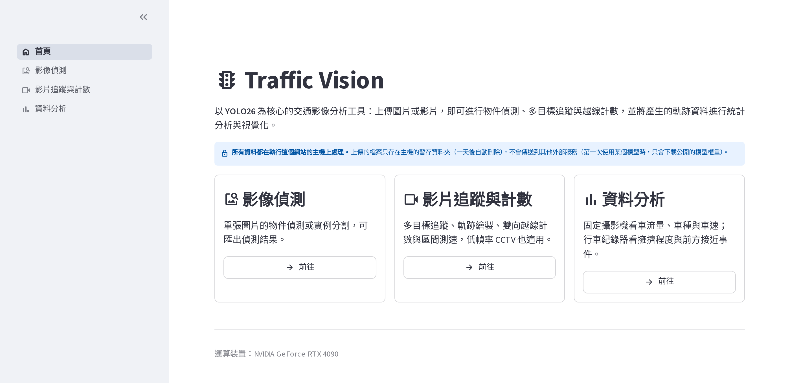
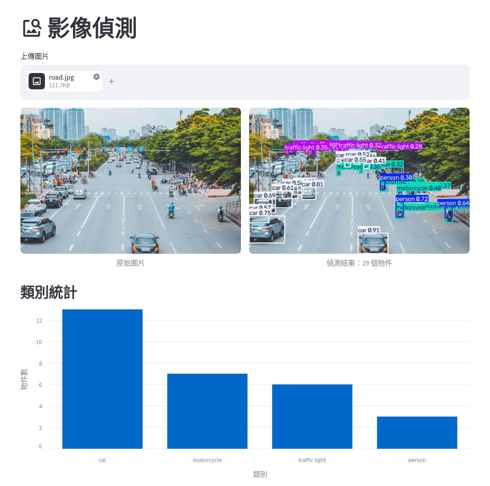
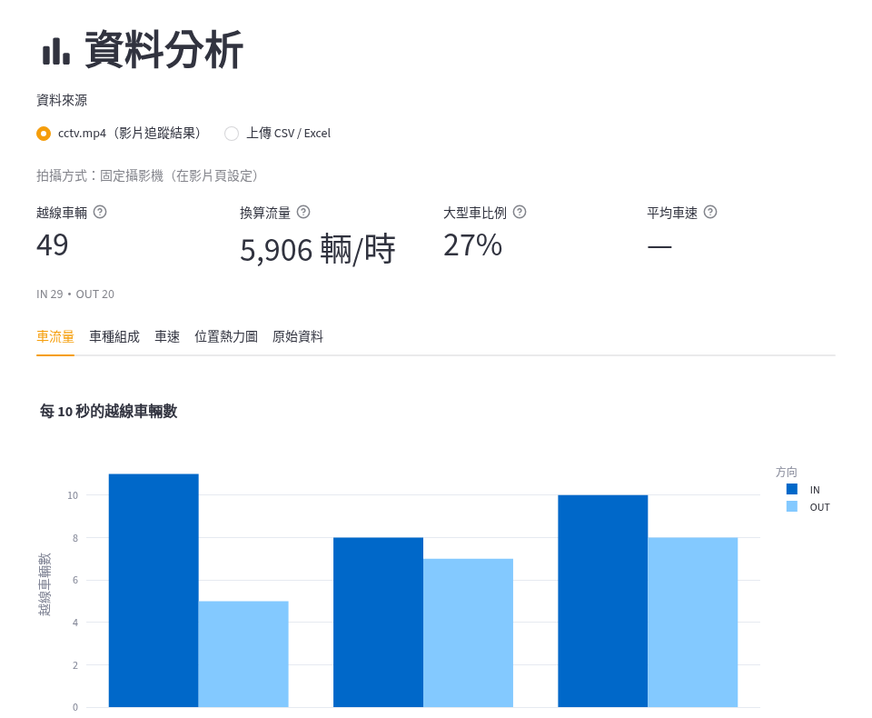

# 🚦 Traffic Vision

**基於 YOLO26 的交通影像分析工具**

🔗 **線上展示：<https://superhero-plow-headway.ngrok-free.dev>**（需要密碼）


<p align="center">
  
</p>

把既有的 CCTV、空拍與行車紀錄器影片，自動轉成交通調查數據：**分方向車流量、車速、車種組成、危險接近事件**。適用於交通量調查、號誌與路口改善評估、道路安全檢視，減少人工逐台計數的成本。

## ⭐ 功能

Web 分成三個頁面，對應「單張影像 → 影片 → 數據分析」的流程。

### 🖼️ 影像偵測

上傳一張圖片，偵測畫面中的車輛、機車、行人等物件，並和原圖並排顯示標註結果。除了一般的框選偵測，也可以切換成實例分割模型，把物件輪廓整塊上色，看得比框選更精細。頁面下方會統計各類別的數量，偵測明細（類別、信心分數、框座標）可以下載成 CSV 或 Excel。

<p align="center">
  
</p>

### 🎞️ 影片追蹤與計數

上傳影片後逐幀偵測，並為每個物件指定固定的 ID 持續追蹤，在影片上畫出移動軌跡。針對國道 CCTV 這類只有約 5 fps 的低幀率影片，追蹤器另外做了調整，不會因為車子一幀移動太多就跟丟。

- **雙向越線計數**：在畫面上拉一條任意角度的計數線，線上的箭頭指向 IN 方向，反方向穿越算 OUT，每台車只計一次。
- **區間測速**：再畫一條測速線並輸入兩線的實際距離，就能用車輛通過兩線的時間差換算 km/h。
- **輸出**：H.264 標註影片，以及每個物件逐幀位置的軌跡資料集（CSV / Excel），可以直接交給「資料分析」頁。

<p align="center">
  
</p>

### 📊 資料分析

讀入影片頁的追蹤結果（或上傳之前下載的 CSV / Excel），依拍攝方式產生不同的分析：

| 拍攝方式 | 分析內容 |
| --- | --- |
| 固定攝影機（CCTV、懸停空拍） | 越線車輛數與換算每小時流量、各方向流量時序、車種組成與大型車比例、車速分布（中位數、85 百分位）、位置熱力圖 |
| 行車紀錄器 | 沿途擁擠程度、行人／機車出現的時間占比、TTC 接近事件（附截圖） |

<p align="center">
  
</p>

### 🧠 模型選用

三個頁面共用側邊欄的模型設定，類別選單會自動對應到各模型的類別名稱。

| 模型 | 適用畫面 |
| --- | --- |
| YOLO26s（預設） | 一般平視：路口監視器、行車記錄器 |
| YOLO26s-visdrone | 無人機、高處俯拍 |
| YOLO26s-idd | 機車、騎士很多的平視街景 |

## ⭐ 快速開始

```bash
python -m venv .venv && source .venv/bin/activate
pip install torch torchvision --index-url https://download.pytorch.org/whl/cu124   # 依 CUDA 版本調整
pip install -r requirements.txt
streamlit run app.py        # http://localhost:8501
```

## 技術細節

### 1. 問題定義

現成的 YOLO 權重是用 COCO（日常照片）訓練的，直接拿來分析交通影像會遇到三個問題：

1. **空拍小物體**：無人機畫面裡的車和機車只有幾個像素大，大部分都偵測不到。
2. **機車密集的平視街景**：機車、騎士很多的路況和 COCO 的資料分布差很多，台灣這類路況特別明顯。
3. **低幀率 CCTV**：國道 CCTV 只有約 5 fps，車子一幀就移動將近一個車身。內建追蹤器靠前後框的 IoU 配對，只留下 3% 的偵測框，越線計數嚴重漏算。

前兩個問題靠針對領域微調來解決，但專用模型換到其他畫面可能會退步，所以也要量化這種跨領域遺忘有多嚴重。

### 2. 方法

#### 資料與評估

| 資料集 | 視角 | 用途 | 評估方式 |
| --- | --- | --- | --- |
| [COCO](https://cocodataset.org/) val2017 | 一般照片 | 預訓練基準、檢查遺忘 | 5,000 張 |
| [VisDrone2019-DET](https://github.com/VisDrone/VisDrone-Dataset) | 無人機空拍 | 微調（問題 1） | test-dev（1,610 張），另依官方規則處理忽略區域 |
| [IDD Detection](https://idd.insaan.iiit.ac.in/) | 印度道路平視 | 微調（問題 2） | 依影片序列切分，避免相鄰幀洩漏到測試集 |
| 國道 1 號湖口 CCTV | 高處固定攝影機，約 5 fps | 驗證追蹤與計數（問題 3） | 人工逐幀計數 |

- 三個資料集的類別不同，跨資料集比較只看共同的 6 類（人、腳踏車、汽車、機車、公車、卡車）。

#### 領域微調

從 COCO 權重開始，對 YOLO26s 做全參數微調，分別訓練空拍（VisDrone，訓練解析度 1536）和平視（IDD，1024）兩個專用模型。最後用 3 個模型 × 3 個測試集的交叉評估量化遺忘程度。

#### 低幀率多目標追蹤

[`traffic_vision/tracking.py`](traffic_vision/tracking.py) 沿用 ByteTrack 的流程（高低信心兩階段配對、遺失後找回），但改了三個地方：

- **配對成本**：把框的 IoU 換成「預測位置與偵測中心的距離」。速度由最近兩次觀測估計，距離以框的大小為單位，所以和幀率、物體遠近都無關。
- **類別去重**：同一台車常同時被判成 car 和 truck，四輪車類別之間先去重。騎士和機車本來就會重疊，所以不合併。
- **新軌跡也能計數**：低幀率下車子可能剛出現就越線，所以還沒確認的軌跡也會把第一個位置交給計數器。

#### 從軌跡算出交通指標

- **雙向越線計數**：用線段相交判斷，計數線可以設成任意角度，每台車只算一次。
- **區間測速**：車速 = 兩條線的實際距離 ÷ 通過時間差，越線時間依前後兩幀內插。
- **TTC 接近事件**（行車紀錄器）：框的大小和距離成反比，因此 TTC = 1 ÷ (d ln s / dt)，不需要知道實際距離。

### 3. 結論

| 問題 | 做法 | 結果 |
| --- | --- | --- |
| 空拍小物體 | 在 VisDrone 上微調 | 共同 6 類 mAP50 **0.206 → 0.487**，機車約提升 4.5 倍 |
| 機車密集的平視街景 | 在 IDD 上微調 | 共同 6 類 mAP50 **0.478 → 0.712** |
| 低幀率 CCTV | 改用距離配對的追蹤器 | 10 秒片段計數 **7 → 12 台**（人工 12–13 台） |
| 跨領域遺忘 | 3 個模型 × 3 個測試集 | 每個專用模型都只在自己的領域最好 |

**問題 1：微調後能抓到密集的小物體。** 下圖是同一張 VisDrone 測試圖（標註了 170 個物件），左邊是 COCO 預訓練模型，右邊是空拍微調模型。


訓練和推論的解析度要一起提高（VisDrone 官方規則，10 類 mAP50）：

| 設定 | mAP50 |
| --- | --- |
| 1024 訓練、1024 推論 | 0.412 |
| 1024 訓練、1536 推論 | 0.447 |
| 1536 訓練、1536 推論 | **0.471** |

只把推論解析度提高到 1536，不必重訓就能多 0.035。起始權重則影響不大：從 COCO 起點或從 Objects365 → DOTA（空拍）起點開始微調，差距不到 0.01。

**問題 2：平視街景的提升比較溫和。** COCO 本來就以平視照片為主，起點已經不低，微調後共同 6 類 mAP50 從 0.478 提升到 0.712。

**問題 3：低幀率追蹤大幅改善。**（國道 1 號湖口 CCTV，YOLO26m，conf 0.2）

| 片段 | 人工計數 | 內建追蹤器 | 本專案 |
| --- | --- | --- | --- |
| 0–10 秒（用來調參數） | 12–13 | 7 | **12** |
| 20–30 秒（獨立驗證） | 約 13 | — | **12** |

30 fps 的行車影片也一起變好：軌跡覆蓋率 83% → 94%，追蹤 ID 數 108 → 85（同一個物件比較不會被切成好幾段）。

**跨領域遺忘明顯。** 空拍模型在 IDD 只剩 0.174，IDD 模型在 VisDrone 只剩 0.034，沒有一個模型能通吃三種畫面，所以 App 讓使用者依畫面選模型。

<p align="center">
  
</p>

完整設定與數字見 [docs/experiments.md](docs/experiments.md)，原始評估報告在 [reports/](reports/)。

### 4. 限制與未來工作

**限制**

- IDD 是印度的道路，車種和街景與台灣不同，還沒有用台灣資料驗證。
- 追蹤器的人工對照只有兩個 10 秒片段，樣本還很小。
- TTC 假設相對速度不變，自己的車煞車時會高估風險，比較適合用來挑出需要回放的片段。

**未來：用一個模型接近三個專用模型的表現。**

- 模型融合：輸出層集成（WBF）、依畫面視角路由，以及權重空間融合（task arithmetic、TIES-merging）。三個模型都從同一個 COCO 權重微調，符合權重融合的前提。
- 多領域聯合訓練：處理各資料集類別定義不一致、互相漏標的問題，例如只對該資料集有標註的類別計算 loss。

評估沿用上面的 3×3 跨資料集表格，以三個專用模型的分數當上限。

## 專案結構

```
traffic_vision/   核心邏輯：偵測、追蹤、越線計數、軌跡分析（不依賴 Streamlit，可直接在 notebook 使用）
training/         資料集轉換、微調、評估（含 VisDrone 官方規則、跨資料集比較）
views/, app.py    Streamlit 介面
deploy/           systemd 服務與安裝腳本
docs/, reports/   實驗紀錄、圖片、評估報告
tests/            單元測試（不需要 GPU 或模型權重）
```

## 來源與授權

本專案改寫自 [Henryers/yolov8-traffic-app](https://github.com/Henryers/yolov8-traffic-app)（AGPL-3.0），沿用了偵測、軌跡與越線計數的功能構想；在此基礎上改成 Streamlit Web App、重寫越線計數，並新增低幀率追蹤器、領域微調與分析頁。程式註解中的「原專案」指的就是它。

依 AGPL-3.0 條款，本專案同樣以 [AGPL-3.0](LICENSE) 釋出；[Ultralytics](https://github.com/ultralytics/ultralytics) 套件與 YOLO 模型也是 AGPL-3.0。

VisDrone 與 IDD 限非商業研究用途，因此本 repo 不包含資料集與微調權重；若要把以它們微調的模型用於商業用途，請先確認各自的使用條款。
