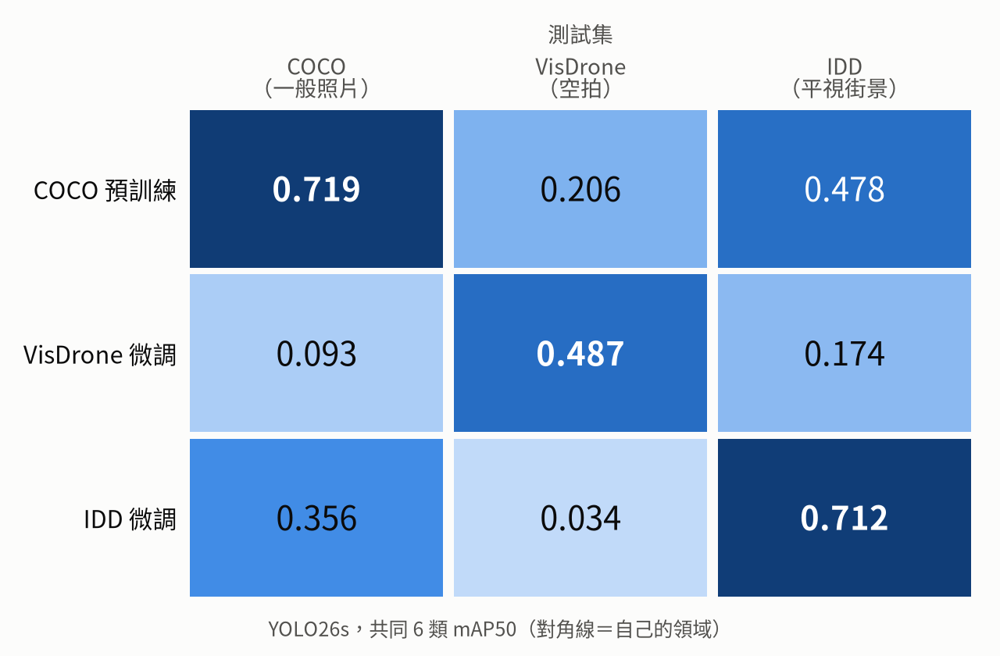

# 🚦 Traffic Vision

**YOLO26 交通影像分析工具**


上傳圖片或影片，就能做物件偵測、多目標追蹤與雙向越線計數，並把產生的軌跡資料做統計分析與視覺化。除了 App 本身，這個專案也把 YOLO26 分別微調到**無人機空拍**（VisDrone）和**機車很多的平視街景**（IDD），並量化「換一個領域，模型會忘掉多少」。

> **所有資料都在你的電腦上處理。** 上傳的檔案只存在本機暫存資料夾，不會送到任何外部服務。App 也關閉了 Ultralytics 預設開啟的匿名使用統計。

## 研究亮點

- **空拍微調**：VisDrone 上共同 6 類 mAP50 從 **0.206 → 0.487**，機車約提升 4.5 倍；以 1536 重訓後，依 VisDrone 官方規則 10 類 mAP50 **0.471**。
- **平視微調**：IDD（印度道路）上共同 6 類 mAP50 從 **0.478 → 0.712**，機車 0.766。
- **災難性遺忘的量化**：每個專用模型都只在自己的領域最好，換到其他領域就大幅下降。
- **可信的評估**：依 VisDrone 官方工具規則處理忽略區域；IDD 依影片序列切分，避免相鄰幀洩漏到測試集；預訓練模型在 COCO 80 類的分數與官方公布值相差不到 1 點。

<p align="center">
  
</p>

## 功能介紹

| 頁面 | 功能 |
| --- | --- |
| 🖼️ 影像偵測 | 單張圖片的物件偵測或實例分割；可調整信心門檻、IoU、推論解析度、要偵測的類別；匯出偵測明細（CSV / Excel） |
| 🎞️ 影片追蹤與計數 | ByteTrack 多目標追蹤與軌跡繪製；計數線可設成任意角度，分別統計 IN / OUT；輸出可以直接在瀏覽器播放的 H.264 標註影片和逐幀軌跡資料 |
| 📊 資料分析 | 各類別物件數、每秒車流量、位置熱力圖、主要軌跡疊圖、單一物件軌跡與移動距離 / 速度 |

不管選哪個模型，側邊欄的類別選單都是同一組（人、腳踏車、機車、汽車、公車、卡車、三輪車……），會自動對應到各模型自己的類別名稱。

## Demo

<!-- 在這裡放 App 操作的 GIF 或截圖，例如： -->
<!-- 部署後可以加上線上展示連結，例如：**線上展示**：https://your-app.streamlit.app -->

同一張 VisDrone 測試圖，一般模型（左）和空拍微調模型（右）的偵測結果，這張圖標註了 170 個物件：


一般模型漏掉大部分機車、行人和遠處的車；微調模型能抓到畫面中密集的小物體。

### 快速開始

```bash
python -m venv .venv && source .venv/bin/activate

# 有 NVIDIA GPU：依驅動版本安裝對應的 PyTorch（例如 CUDA 12.4）
pip install torch torchvision --index-url https://download.pytorch.org/whl/cu124

pip install -r requirements.txt
streamlit run app.py
```

用瀏覽器開啟 <http://localhost:8501>。第一次使用某個模型時，會自動把權重下載到 `weights/`。

Docker（CPU）：

```bash
docker build -t traffic-vision .
docker run --rm -p 8501:8501 traffic-vision
```

## 模型選用

| 模型 | 適用畫面 | 類別 | 訓練解析度 | 自己領域的成績 |
| --- | --- | --- | --- | --- |
| **YOLO26s（平衡）**，預設 | 一般平視畫面：路口監視器、行車記錄器 | COCO 80 類 | 640 | COCO 6 類 mAP50 0.719 |
| **YOLO26s-visdrone（空拍 / 俯視）** | 無人機、高處俯拍 | 行人、人、腳踏車、汽車、廂型車、卡車、三輪車、有篷三輪車、公車、機車 | 1536 | VisDrone 10 類 mAP50 0.471（官方規則） |
| **YOLO26s-idd（平視 / 行車）** | 機車、騎士很多的平視街景 | 人、騎士、腳踏車、機車、汽車、電動三輪車、公車、卡車等 12 類 | 1024 | IDD 12 類 mAP50 0.587 |

選單另外還有 YOLO26n（最快）、YOLO26m（較準）和 YOLO26s-seg（實例分割）。兩個微調模型需要先自己訓練（見下一節），訓練好的權重放進 `weights/custom/` 後，選單會自動出現。

**推論解析度**：側邊欄預設「自動」，沿用模型訓練時的設定，一般用自動即可。空拍畫面的物體很小，解析度很重要：同一個 1024 訓練的模型，改用 1536 推論 mAP50 就從 0.404 提升到 0.439；但再往上到 2048 反而會變差。

> 一般模型幾乎認不出從空中拍的車和機車；反過來，空拍模型拿來看平視畫面也不行（見上方熱力圖）。請依畫面視角選模型。

## 微調介紹與實驗

官方 YOLO 權重是用 COCO（日常照片）訓練的，對空拍畫面裡只有幾個像素大的車和機車效果有限。`training/` 提供完整的資料準備、微調、評估流程：

```bash
python -m training.datasets visdrone      # 下載並轉換 VisDrone（約 2 GB）
python -m training.finetune               # 微調：YOLO26s、imgsz 1024、提早停止
python -m training.evaluate --weights weights/custom/visdrone-yolo26s.pt --split test
python -m training.visdrone_eval --weights weights/custom/visdrone-yolo26s.pt --split test  # 官方規則
python -m training.crossdomain            # COCO / VisDrone / IDD 跨資料集比較
```

所有分數都來自訓練過程完全沒用到的測試集；驗證集只用來挑最佳 epoch。

| 實驗 | 做法 | 結果 |
| --- | --- | --- |
| VisDrone 空拍微調 | 從 COCO 權重全參數微調，imgsz 1024 | test-dev 10 類 mAP50 0.404 |
| 推論解析度 | 同一個模型用 1024 / 1280 / 1536 / 2048 推論 | 1536 最好（0.439），2048 反而下降 |
| 以 1536 重訓 | 訓練和推論都用 1536 | 官方規則 0.447 → **0.471**；只提高推論解析度不夠，訓練要一起提高 |
| 依官方規則重算 | 排除落在忽略區域的標註和預測，使用官方的配對與 AP 算法 | 約 +0.007，提升集中在機車、行人等小物體 |
| 起始權重 | COCO 起點 vs Objects365 → DOTA 空拍起點 | 差距 < 0.01，打平 |
| IDD 平視微調 | 依影片序列切分，12 類 | 6 類 0.478 → **0.712** |
| 跨資料集比較 | 三個模型 × 三個測試集，只比共同 6 類 | 對角線最高，換領域明顯遺忘 |

**完整的設定、數字和分析請見 [docs/experiments.md](docs/experiments.md)**，原始報告在 [reports/](reports/)。

**目前的限制**：IDD 是印度的道路，車種組成和招牌與台灣不同，用在台灣畫面上的效果還沒有用台灣資料驗證過。

## 未來工作

目前每個領域各有一個專用模型。接下來想研究怎麼用**一個模型**同時接近三個專用模型的表現：

- **模型融合**：集成兩個專用模型的輸出（WBF / NMS）、依畫面視角路由，以及在權重空間融合（task arithmetic、TIES-merging）。兩個模型都從同一個 COCO 權重微調，滿足權重融合的前提。
- **多領域聯合訓練**：先在共同 6 類上混合 VisDrone、IDD 和部分 COCO 訓練；再處理各資料集類別定義不一致、互相漏標的問題（例如只對該資料集有標註的類別計算 loss）。

評估沿用上面的 3×3 跨資料集表格，以三個專用模型的分數當上限。

## 資料收集：湖口路段

持續收集國道 1 號南向 84K+600（湖口交流道 - 湖口服務區）的 CCTV 影片，以及同一路段的官方偵測資料，作為影像分析的驗證基準。

| 資料 | 來源 | 頻率 | 存放位置 |
| --- | --- | --- | --- |
| CCTV 影片（18460 鏡頭，352×240） | 高公局 MJPEG 串流 | 06–10、16–20 點每 5 分鐘錄 60 秒，其他時段每 30 分鐘 | `data/raw/cctv/18460/<日期>/` |
| VD 車輛偵測器（84.12K、85.02K 南向，83.59K、85.01K 北向） | 高公局開放資料 VDLive | 每分鐘 | `data/raw/official/<日期>/vd.csv.gz` |
| ETC 門架（湖口 → 新竹交流道） | TDCS M03A / M04A / M05A | 每 5 分鐘 | `data/raw/official/<日期>/m0*.csv.gz` |

```bash
python -m collector.record                      # 手動錄一段 60 秒
python -m collector.official --date 20261102    # 下載指定日期的官方資料
./deploy/install-collector.sh                   # 安裝 systemd user timer，自動排程
```

- 串流大約每 9 秒斷線一次，錄影程式會自動重連。每段影片都附有 `.frames.csv`，記錄每一幀的接收時間和攝影機 EXIF 時間；`.json` 記錄斷線次數和實際有畫面的秒數。分析時以這兩個檔案為準，不要用影片的 fps 推算時間。
- 84.12K ~ 85.02K 之間沒有匝道，通過鏡頭的南向車流量應和這兩個 VD 一致。
- 官方資料每天 04:00 下載前一天的份量，電腦關機錯過時，下次會補抓最近 3 天缺少的日期。
- 排程在使用者登出後也要繼續執行的話，需要執行 `loginctl enable-linger`。

## 專案結構

```
app.py                  Streamlit 進入點與頁面導覽
views/                  各頁面 UI
traffic_vision/
  counting.py           越線計數（線段相交判斷，含方向）
  video.py              追蹤、軌跡繪製、H.264 輸出
  detection.py          單張影像偵測
  analytics.py          軌跡資料集的欄位正規化與統計
  labels.py             中文類別名稱與統一類別選單
  models.py             模型清單與權重管理（含 weights/custom/ 的微調模型）
collector/
  config.py             收集對象（鏡頭、VD、門架）與錄影排程
  record.py             錄 CCTV 串流（自動重連、逐幀時間）
  official.py           下載官方 VD 與 ETC 門架資料
deploy/                 systemd timer 與安裝腳本
training/
  datasets.py           資料集下載與轉換
  finetune.py           微調
  evaluate.py           官方驗證器評估報告
  compare.py            多個模型的評估報告比較表
  crossdomain.py        COCO / VisDrone / IDD 跨資料集比較（預訓練 vs 微調）
  idd.py                IDD Detection 轉成 YOLO 格式（依影片序列切分）
  visdrone_eval.py      依 VisDrone 官方規則評估（忽略區域、官方計分）
docs/                   實驗紀錄與圖片
reports/                評估報告
tests/                  單元測試（不需要 GPU 或模型權重）
```

UI 和運算邏輯是分開的：`traffic_vision/` 不依賴 Streamlit，可以直接在 notebook 或其他服務裡使用。

開發：

```bash
pip install -r requirements-dev.txt
pytest -q
ruff check .
```

## License

### 來源與授權

本專案是以 [Henryers/yolov8-traffic-app](https://github.com/Henryers/yolov8-traffic-app)（AGPL-3.0）為基礎重新設計、改寫的衍生作品，功能構想（偵測、軌跡、越線計數、資料集分析）沿用自原專案。

和原專案相比的主要差異：

- **介面**：PyQt5 桌面程式改成 Streamlit Web 介面，拿掉 MySQL 帳號登入，改成以本機上傳為主
- **架構**：原本 1,300 多行的單一檔案拆成彼此獨立、可以測試的模組；不再把整份 ultralytics 原始碼放進 repo，改成依賴官方套件，並升級到 YOLO26
- **越線計數**：原本只判斷「y 座標是否小於固定值」，物件只要出現在線的上方就會被計數；現在改成線段相交判斷，支援任意角度的計數線和 IN / OUT 方向，每個物件只計數一次
- **追蹤正確性**：每支影片會重置追蹤器，物件 ID 不會延續到下一支影片
- **影片輸出**：從 OpenCV mp4v 改成 H.264，不必再另外安裝 LAV Filters 解碼器
- **資料分析**：新增車流量時序圖、軌跡疊圖、移動距離 / 速度統計，同時相容原專案匯出的資料格式
- **微調與研究**：VisDrone / IDD 微調、依官方規則的評估、解析度實驗、跨資料集遺忘分析（原專案沒有）
- **工程**：單元測試、ruff、GitHub Actions CI、Docker；拿掉寫死在程式裡的資料庫密碼和本機路徑

依 AGPL-3.0 條款，本專案同樣以 [AGPL-3.0](LICENSE) 授權釋出。YOLO 模型與 [Ultralytics](https://github.com/ultralytics/ultralytics) 套件也是 AGPL-3.0 授權。

### 資料集

本 repo 不包含資料集和微調後的權重。[VisDrone](https://github.com/VisDrone/VisDrone-Dataset) 和 [IDD](https://idd.insaan.iiit.ac.in/) 都有各自的使用條款（限非商業研究用途），請自行下載並遵守。README 中的空拍對比圖取自 VisDrone 測試集。
